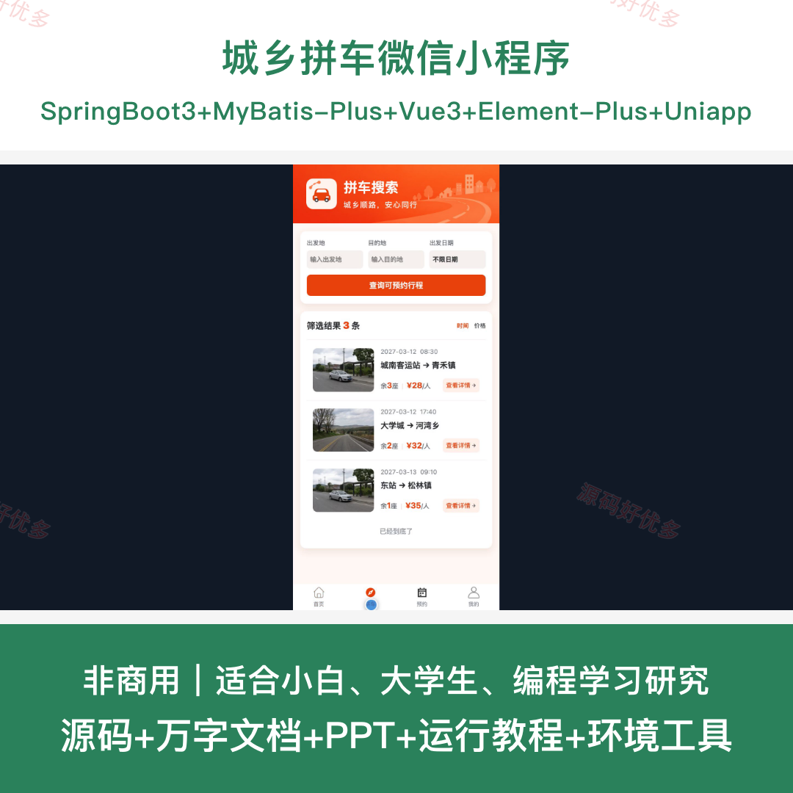
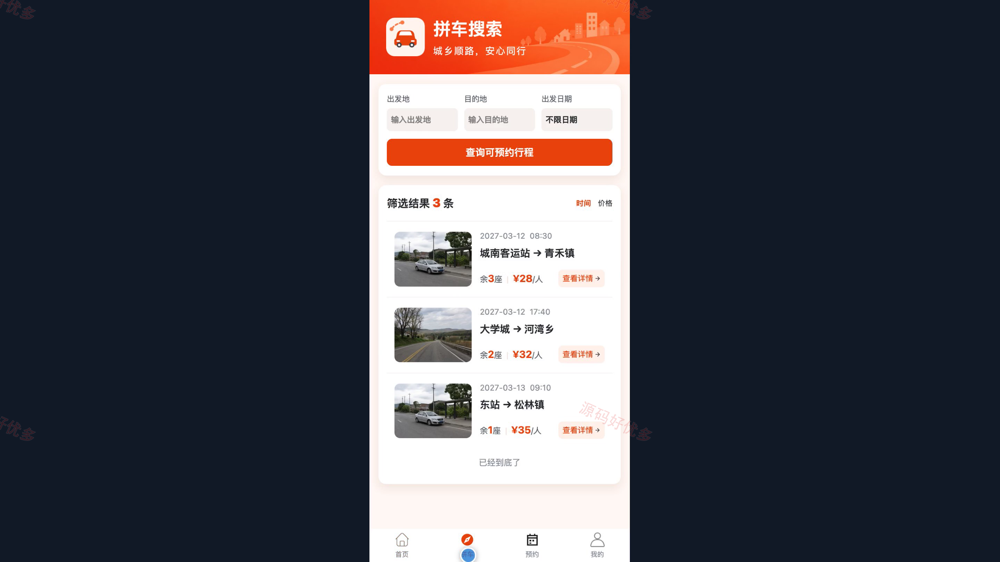
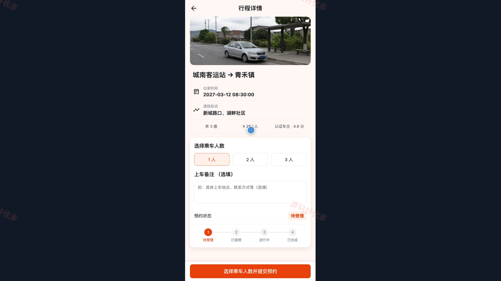
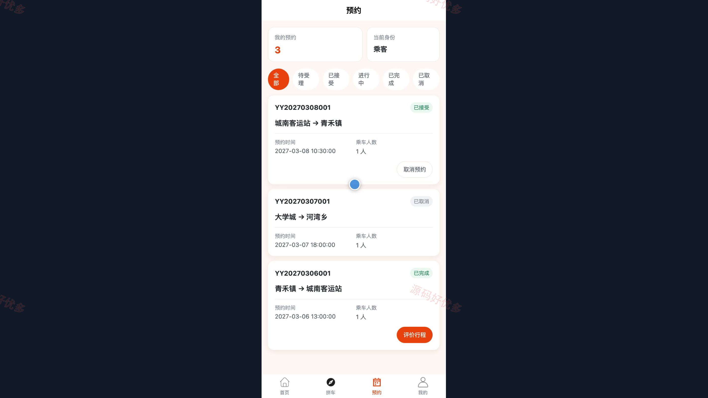
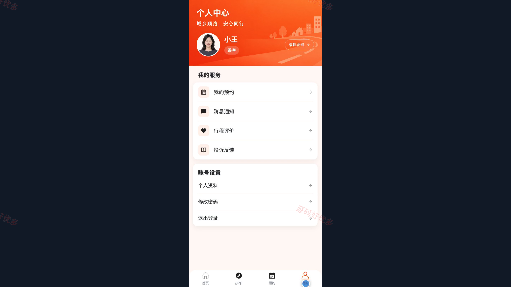
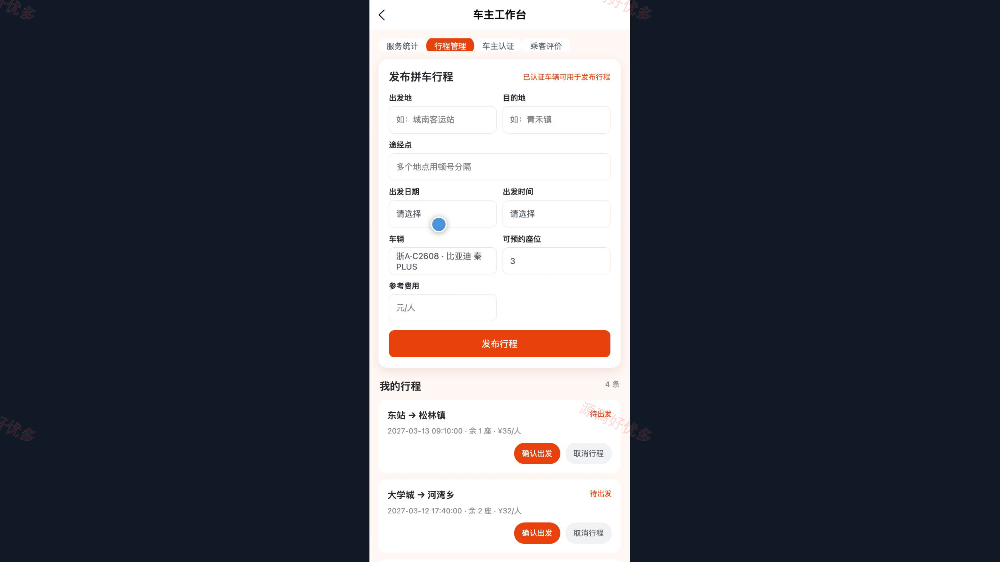
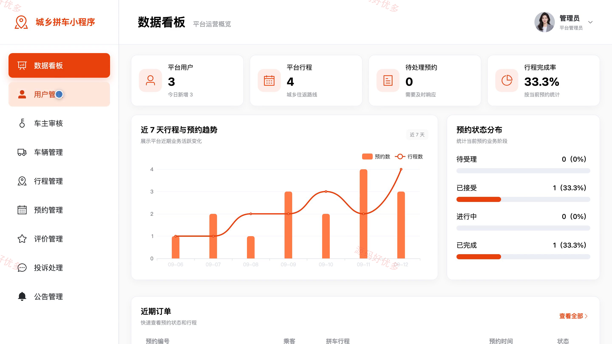
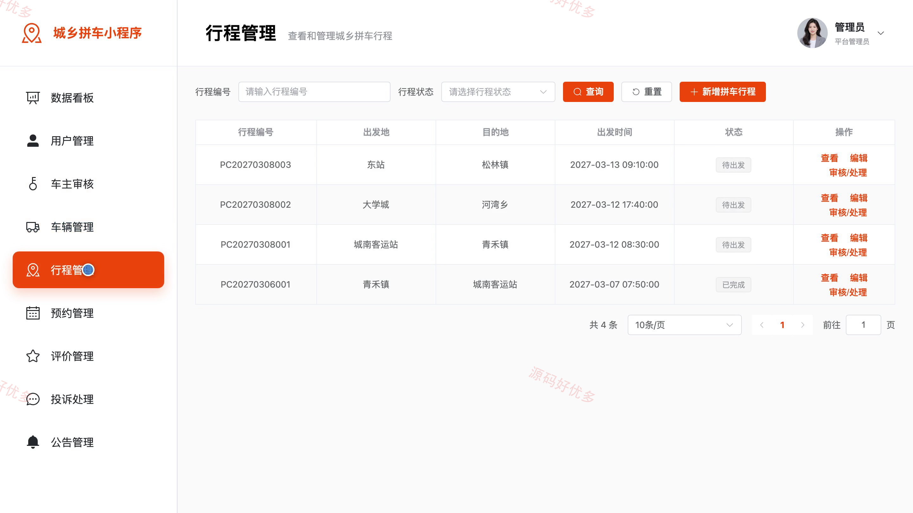
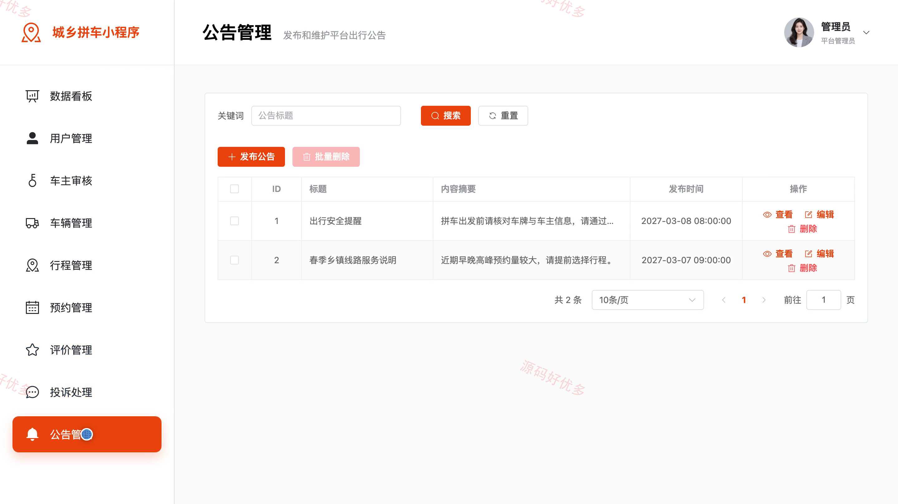

## 源码问题查看主页咨询

### 一、关键词
城乡拼车、顺风车预约、同城合乘、行程发布、车主认证

### 二、作品包含
源码+数据库+万字设计文档+PPT+全套环境和工具资源+本地部署教程

### 三、项目技术
前端技术： Html、Css、Js、Vue3.4、Element-Plus、uniapp
后端技术：Java、SpringBoot3.2.0、MyBatis-Plus

### 四、运行环境要求
开发工具：IDEA/eclipse + VSCODE + HBuilder X + 微信开发者工具

数据库：MySQL5.7+（共13张表）

数据库管理工具：Navicat10以上版本

环境配置软件： JDK17 + Maven3.6.3

前端Nodejs：20

浏览器：谷歌浏览器

### 五、项目介绍
项目编号：bs064B

本项目面向城乡间合乘出行场景，提供小程序乘客端、车主端与 PC 管理端。乘客可按起止地点和日期查找行程、提交预约、跟踪状态并进行评价投诉；车主可完成认证、车辆资料维护、行程发布和预约受理；管理员负责资质审核、行程与预约监管、评价投诉处理及公告维护。

角色：乘客、车主、管理员

乘客功能：注册登录、拼车行程搜索、行程详情查看、拼车预约与取消、预约状态查看、行程评价、消息通知、投诉反馈。

车主功能：注册登录、车主认证与车辆资料、拼车行程发布、行程维护与取消、乘客预约受理、乘客名单查看、行程状态更新与接单统计、乘客评价查看。

管理员功能：用户账号管理、车主资质审核、车辆管理、拼车行程管理、预约记录管理、行程评价管理、投诉受理、公告维护与数据统计。

### 六、运行截图

